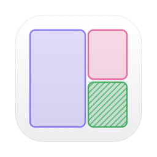
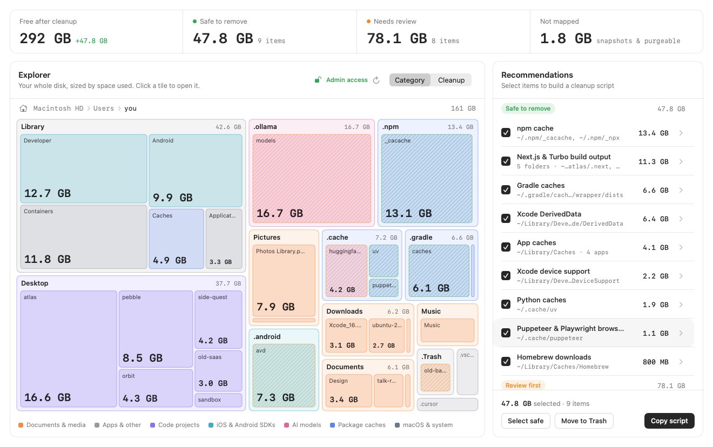
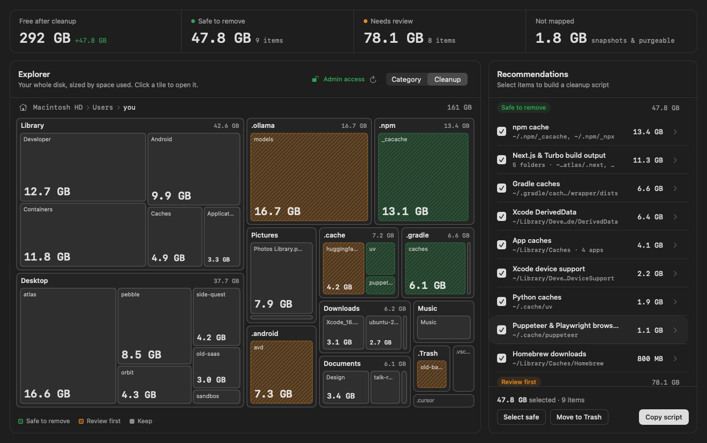
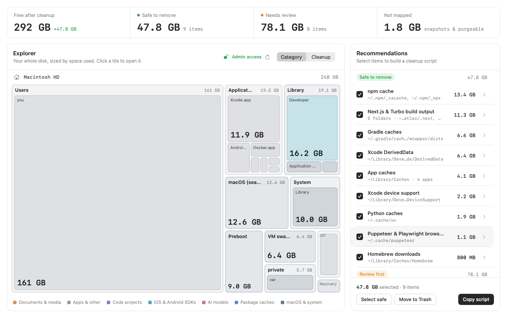
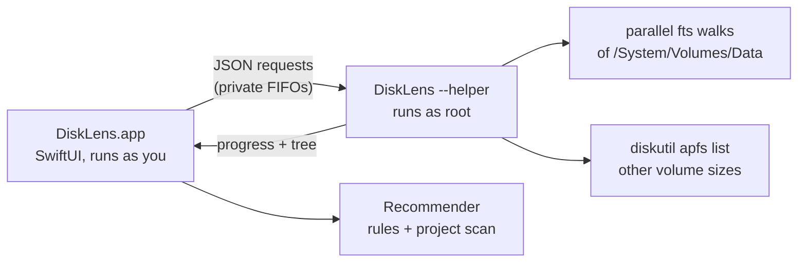

<div align="center">



# DiskLens

**See what's filling your Mac, and clean up the developer junk safely.**

A small, native macOS app that maps your whole disk as a treemap and finds
caches, build output and SDKs you can get back. No Electron, no telemetry, nothing
deleted behind your back.

[](https://github.com/mralifakbar/disklens/actions/workflows/ci.yml)
[](https://github.com/mralifakbar/disklens/releases/latest)


[](LICENSE)



</div>

## Features

- **The whole disk, not just your home folder.** DiskLens walks the APFS Data
  volume and shows the sealed macOS, Preboot, Recovery and VM volumes with the sizes
  APFS reports for them, so almost nothing is left as "other". It shows what it
  couldn't map and why.
- **Fast.** A parallel `fts(3)` walk, the same traversal `du` uses, maps around 2.6
  million files in about 20 seconds on an M-series Mac, using about 50 MB of memory.
- **Accurate sizes.** It counts allocated blocks, the way `du` does, so sparse
  files and cloud placeholders count for the space they really take.
- **Developer-aware recommendations.** npm, Yarn, pnpm, Bun, pip/uv, Gradle,
  Maven, Cargo, Go, CocoaPods, Dart/Flutter, Kotlin/Native, Xcode DerivedData,
  simulators, Android SDKs, Ollama/LM Studio/Hugging Face models, Docker, idle
  `node_modules`, `.next`/`.turbo` output, leftover Claude Code worktrees and more.
- **Safe by design.** Nothing is deleted automatically. You either copy a cleanup
  script and read it before running it, or move items to the Trash, where you can
  put them back.
- **Runs as admin when you allow it.** One standard macOS password prompt starts a
  small root helper, so system folders get measured too. Cancel it and DiskLens
  scans as you instead.
- **Light and native.** SwiftUI, about 3 MB universal binary, light and dark mode.

<table>
  <tr>
    <td></td>
    <td></td>
  </tr>
  <tr>
    <td align="center"><sub>Cleanup view: green is safe to remove, orange needs a look</sub></td>
    <td align="center"><sub>The whole disk, including volumes you can't browse</sub></td>
  </tr>
</table>

## Install

### Download

1. Grab `DiskLens-x.y.z.zip` from the [latest release](https://github.com/mralifakbar/disklens/releases/latest).
2. Unzip it and move **DiskLens.app** to `/Applications`.
3. The app is ad-hoc signed, not notarized, so the first time macOS will block it.
   Right-click the app and choose **Open**, or run:

   ```sh
   xattr -dr com.apple.quarantine /Applications/DiskLens.app
   ```

### Build from source

Requires macOS 14 or later and Xcode 15.3 or later (Swift 5.10).

```sh
git clone https://github.com/mralifakbar/disklens.git
cd disklens
./build.sh --install      # builds build/DiskLens.app and copies it to /Applications
```

`./build.sh --universal --zip` builds what releases ship: an arm64 + x86_64 app and a zip.

## Usage

Open DiskLens. It asks for your admin password, then maps the disk.

- **Click a tile** to open it, use the breadcrumb or <kbd>Esc</kbd> to go back, and
  the house button to jump to your home folder.
- **Right-click a tile** to reveal it in Finder or copy its path.
- **Category / Cleanup** switches between coloring by kind of data and coloring
  by what you can remove.
- **Recommendations** are preselected when they are safe. The chevron on each row
  lists every folder in it, with its size.
- **Copy script** puts a commented `zsh` script on the clipboard. **Move to Trash**
  moves the selected folders to the Trash, and the confirmation that follows has an
  **Empty Trash** button.
- <kbd>⌘R</kbd> rescans.

### Full Disk Access

Running as root is not enough for folders protected by macOS privacy controls (Mail,
Messages, Safari, other apps' sandboxes). If DiskLens shows "items couldn't be
read", add it under **System Settings › Privacy & Security › Full Disk Access** and
rescan. The banner lists what was skipped.

### Command line

```sh
/Applications/DiskLens.app/Contents/MacOS/DiskLens --scan   # disk summary + recommendations, no window
/Applications/DiskLens.app/Contents/MacOS/DiskLens --demo   # the app with sample data
```

## What it recommends

| Group | Examples | Default |
|---|---|---|
| Package manager caches | npm, Yarn, pnpm, Bun, pip/uv/Poetry, Gradle, Maven, Cargo, Go, CocoaPods, pub, Kotlin/Native, Homebrew | Safe, preselected |
| Build output | Xcode DerivedData, device support, simulator caches, `.next`, `.turbo`, editor caches | Safe, preselected |
| App caches | `~/Library/Caches/*`, except Apple's and the ones above | Safe, preselected |
| SDKs and runtimes | Android SDK and emulators, iOS simulators, Xcode archives, Flutter versions (fvm) | Review |
| AI models | Ollama, LM Studio, Hugging Face | Review |
| Your stuff | `node_modules` in projects idle for 30+ days, Claude Code worktrees, downloads older than 90 days, iPhone backups, Docker disk image, Trash | Review |

Items that need a tool to clean up properly (simulators, Docker, the Trash) use that
tool's command in the script instead of `rm`, and are never moved to the Trash
directly. The rules live in
[`Recommender.swift`](Sources/DiskLens/Core/Recommender.swift). Adding one is a
few lines; see [CONTRIBUTING.md](CONTRIBUTING.md).

## How it works



- **Scanner** (`Core/Scanner.swift`). The Data volume is split into jobs (top-level
  folders, plus heavy ones such as `~/Library/Containers`, where every app sandbox
  costs a permission check), and a worker pool walks them with `fts_open` in physical,
  same-device mode. Nodes are kept four levels deep and trimmed to 40 children each.
  Anything deeper is summed and loaded on demand when you drill in.
- **Root helper** (`Core/Helper.swift`). The app creates two FIFOs in its private
  temp folder and asks `osascript` to start its own binary with `--helper` as
  root. The helper opens the FIFOs, answers one JSON request per line, and exits as
  soon as the app closes its end, which also happens if the app crashes. See
  [SECURITY.md](SECURITY.md).
- **Recommender** (`Core/Recommender.swift`). Rules are matched against the scanned
  tree first, so most sizes are free. Project folders (`node_modules`, `.next`,
  `.turbo`, worktrees) are found during the walk itself.
- **Treemap** (`Core/TreemapLayout.swift`, `UI/TreemapView.swift`). A squarified
  layout two levels deep, drawn with a single SwiftUI `Canvas`.

## Privacy

DiskLens makes no network requests and collects nothing. Scan results stay in
memory and are gone when you quit.

## Development

```sh
swift build                # debug build
swift test                 # unit tests
./build.sh && open build/DiskLens.app
```

Use `--demo` to work on the UI without scanning your disk, and `DISKLENS_NO_ADMIN=1`
to skip the password prompt. [CONTRIBUTING.md](CONTRIBUTING.md) lists every
development switch, including the one that renders the README screenshots.

## Inspiration

DiskLens started after I saw [this post by @jayypatel18](https://x.com/jayypatel18/status/2110433209909743939):
Claude mapped a full Mac disk, found 97 GB of junk and built a cleanup UI for it.
The layout of this app (stat cards, treemap explorer, recommendations with a cleanup
script) comes from that screenshot. Thanks for the idea!

## Contributing

Bug reports, new cleanup rules and pull requests are welcome. Start with
[CONTRIBUTING.md](CONTRIBUTING.md). To report a security issue, follow
[SECURITY.md](SECURITY.md) instead of opening an issue.

## License

[MIT](LICENSE) © Alif Akbar Kartadinata
